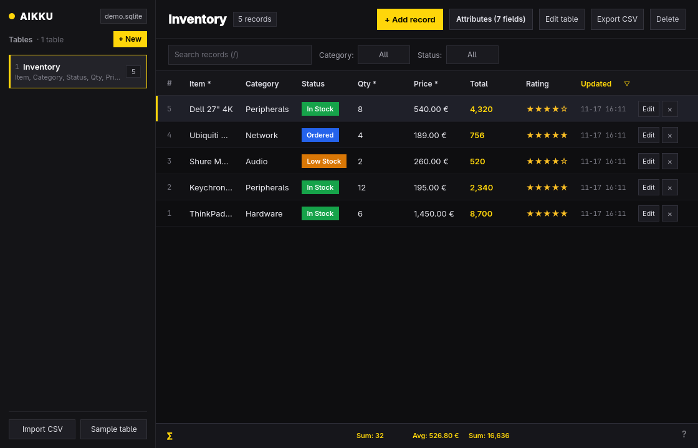

# Aikku Database

A keyboard-first custom SQLite tables and collections manager for Omarchy, inspired by [Aikku Access](https://github.com/philippe-nougaillon/aikku-access). Model tables, define typed attributes and relations, enter and edit records through dynamically generated forms, search and filter, compute formulas and footer aggregations, and import or export CSV collections.



## Features

- **Custom Tables & Attributes**: Create tables and define attributes of type `Text`, `Number`, `Euros`, `Date`, `Yes / No`, `List`, `Status` (colored badges), `Relation` (link to another table via `Table:Attribute`, e.g. `Clients:name`), `Formula` (e.g. `[Qty] * [Unit Price]`), `Tags`, `Stars` (`1–5`), `URL`, `Email`, `Image`, and `File` (embedded directly in SQLite).
- **Table Relations**: Reference records from another table with an interactive source table and display attribute picker, target validation, and choice chips (including an optional `None` option) in record forms.
- **Embedded Images & Files**: Attach images or arbitrary files (PDF, text, Markdown, Office docs, archives, up to 25 MB) via the XDG desktop portal or drag-and-drop, stored inside the `.sqlite` file. Images render as grid thumbnails with a click-to-zoom lightbox (`+`/`-`/`0`, scroll wheel, or click to toggle zoom, `Esc` to close); files render as clickable chips that open in your default desktop app and can be exported back to disk with **Save as…**.
- **Dynamic Record Forms**: Automatically builds and sizes an input form from each table's ordered attributes with required-field validation and "Save & add another" (`submit_and_refill`).
- **Adaptive Data Grid**: Auto-sizes columns to fit headers, cell values, and footer totals with horizontal scrolling (`Shift` + scroll wheel or trackpad) for wide tables, and right-aligns numeric columns (`Number`, `Euros`, and `Formula`) across headers, rows, and footers.
- **Search, Quick Filters & Sorting**: Full-text search across records, per-attribute quick filters (`filtre` flag) and date-range filters, column sorting, and sticky footer `Sum` / `Average` aggregations.
- **CSV Import & Export**: Import CSV files into a new table (auto-detecting `Text`, `Number`, `Date`, and `Yes / No` columns) or export any table to CSV.
- **Single SQLite Database**: Stores all tables, fields, and values in `~/.local/share/aikku-database/aikku-database.sqlite` (or any `.sqlite` file passed on the command line or opened via the XDG desktop portal).
- **Omarchy Native**: Follows the Omarchy accent color, Hyprland window rounding, and system language live.

## Keyboard Shortcuts

| Key | Action |
| --- | --- |
| `Space` | Add a new record (or create a table / define attributes when empty) |
| `Enter` | Edit the selected record |
| `Up` / `Down` | Select previous / next record |
| `X` / `Delete` | Delete the selected record |
| `N` | Create a new table |
| `R` | Rename or edit the current table |
| `F` | Manage table attributes (schema) |
| `1`–`9` | Switch to table 1–9 |
| `/` | Focus the search box |
| `I` | Import a CSV file into a table |
| `E` | Export the current table to CSV |
| `O` | Open a SQLite database file |
| `Ctrl+Z` / `Ctrl+Shift+Z` | Undo / Redo |
| `?` | Show keyboard shortcuts overlay |
| `Q` | Quit (asks first if a form has unsaved changes) |

## Headless CLI

`aikku-database` includes headless commands for scripts and coding agents:

```bash
aikku-database tables [--db <path>] [--json]
aikku-database check [--db <path>] [--json]
aikku-database import <file.csv> [--db <path>] [--json]
aikku-database export <table-name> <output.csv> [--db <path>] [--json]
aikku-database skill [install]
```

## Build, Test & Install

```bash
bin/build
bin/test
bin/install
```

## License

MIT. See `LICENSE`.
